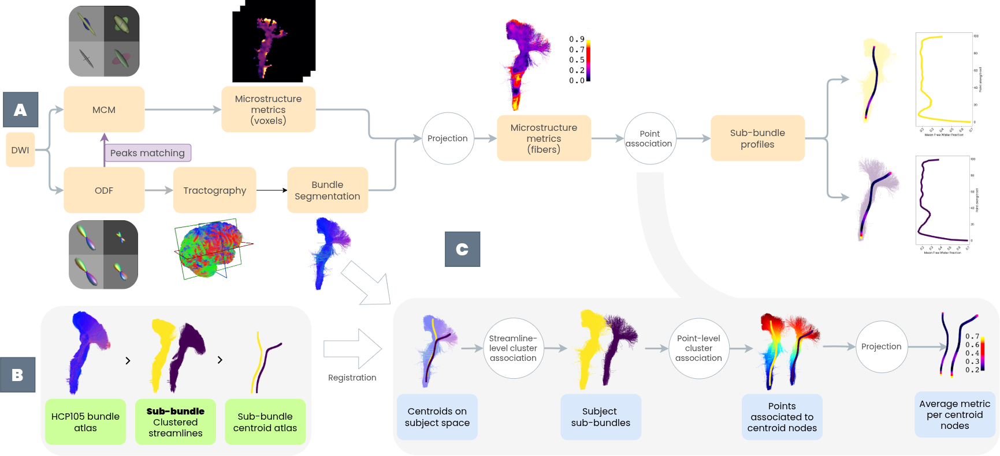
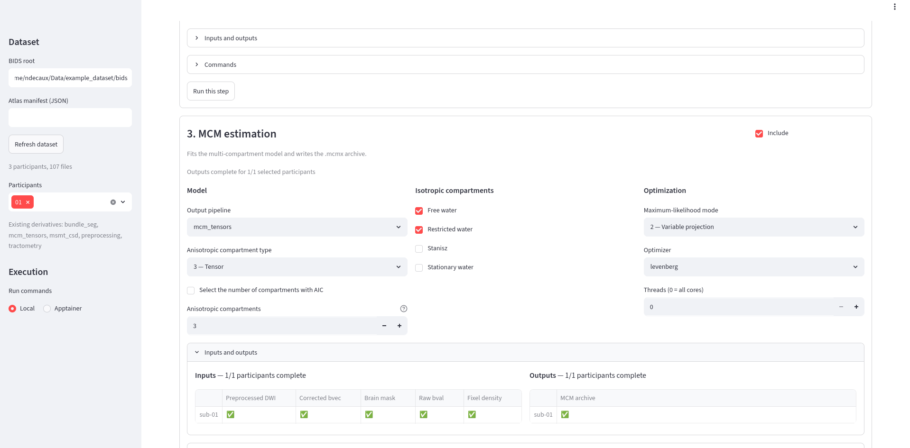

# TractoPL

Diffusion MRI processing for BIDS datasets, focused on multi-compartment models (MCM) and
tractometry: from the raw DWI to population-level analysis of bundle profiles, with command-line
tools, a Python API and web applications to run and explore everything.



Each processing stage writes to `derivatives/<pipeline>/` of the dataset, using BIDS entities to
find its inputs and name its outputs. The supported workflow is:

1. preprocessing (denoising, distortion correction, DTI, FA),
2. FODs, fixels and iFOD2 tractography (MRtrix3),
3. MCM fitting (Anima),
4. bundle segmentation from an atlas,
5. projection of MCM metrics onto the bundles and tractometry CSV files,
6. population analysis (group comparisons, correlations, FWE correction, reports).

## Installation

| Method | Command | Use |
|---|---|---|
| **pixi** (recommended) | `git clone https://github.com/nathandecaux/TractoPL.git && cd TractoPL && pixi install` | full environment with the web applications, reproducible (`pixi.lock`) |
| **conda / pixi package** | `pixi add --channel https://prefix.dev/tractopl tractopl` | add TractoPL to another pixi or conda environment |
| **pip** | `pip install "TractoPL[dashboard] @ git+https://github.com/nathandecaux/TractoPL.git"` | existing Python environment |
| **Apptainer** | `apptainer build --fakeroot tractopl.sif apptainer/TractoPL.def` | all external tools (Anima, MRtrix3, ANTs) included |

Wheels and conda packages of each version are attached to the
[releases](https://github.com/nathandecaux/TractoPL/releases). TractoPL calls external programs
(Anima, MRtrix3, ANTs, TractSeg, FSL) that pip and conda do not install: see
[docs/installation.md](docs/installation.md) to install and configure them.

## Quick start

```shell
pixi run gui                      # or: tractopl-gui
```

The home page starts the web applications: the **pipeline launcher** detects your dataset, finds
each participant's files, runs the workflow step by step and shows where each participant stopped;
the **population analysis**, **dashboard** and **report** pages explore the tractometry results.



From the command line, one participant:

```shell
bash examples/run_workflow.sh /data/my-bids-dataset /data/my-atlas/atlas.json 01
```

Every command accepts `--help`.

## Documentation

- [Installation](docs/installation.md): pixi, pip, conda package, external tools and their configuration
- [Processing workflow](docs/workflow.md): dataset, atlas, command-line tools, typical commands
- [Web applications](docs/applications.md): launcher, dashboard, population analysis and reports
- [Apptainer](docs/apptainer.md): container with all the external tools
- [Development and releases](docs/development.md)

## Related tools

- [TractViewer](https://github.com/nathandecaux/TractViewer): viewer for tractograms, surfaces and
  NIfTI volumes, with headless rendering of images and rotation GIFs.
- [HCP105 bundle templates](https://zenodo.org/records/22641462): brings the HCP105 white-matter
  reference tracts into a shared atlas space and builds bundle-wise tractogram templates.
