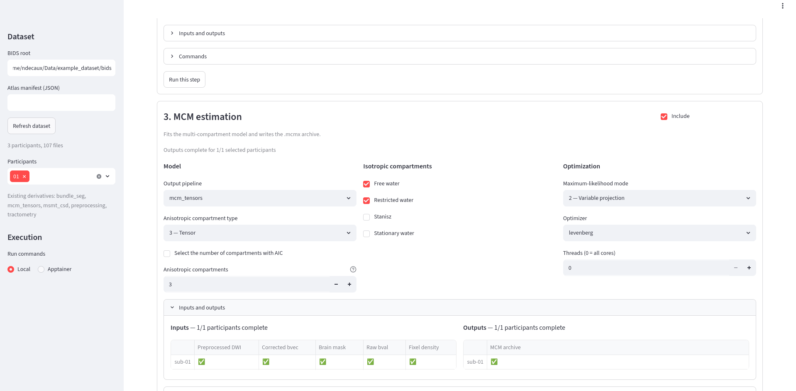

# Web applications

The applications need the `dashboard` dependencies (installed by default with pixi, or
`pip install 'TractoPL[dashboard]'`). Start the home page:

```shell
tractopl-gui            # or: pixi run gui
```

| Command | Application |
|---|---|
| `tractopl-gui` | Home page: starts any of the applications below and links to them. |
| `tractopl-gui-pipeline` | [Pipeline launcher](#pipeline-launcher) (`dashboard/streamlit_launcher.py`). |
| `tractopl-gui-analysis` | Population analysis configuration and run (`analysis/streamlit_analysis.py`). |
| `tractopl-gui-dashboard` | [Tractometry dashboard](#tractometry-dashboard) (`dashboard/streamlit_dashboard.py`). |
| `tractopl-gui-report` | Results browser for `summary_results.csv` (`analysis/report_analysis.py`). |

Each command accepts `--port` and `--no-browser`; other arguments go to the application
(Streamlit options, or the CSV path for `tractopl-gui-report`).

## Pipeline launcher



Enter the BIDS root and atlas manifest in the sidebar. The launcher indexes the dataset with
`Dataset`, lists the detected participants, and offers the existing derivative pipelines wherever
a step needs one.

Each workflow step gets its own block with its options, the exact command lines it will run for
the selected participants, and a button to run that step alone. *Run the included steps* runs
every checked block in order and stops at the first failure.

Each block also shows, per participant, which of its inputs and expected outputs exist in the
dataset. Outputs of one step are the inputs of the next ones, so the tables show where a
participant stopped. After each command the launcher re-indexes the dataset and treats missing
outputs as a failure, because some commands report errors without a non-zero exit code.

To run inside Apptainer, select `Apptainer` under *Execution*, choose the `.sif` image and the
TractoPL checkout, and press *Load image*. Loading checks that the image imports TractoPL from the
mounted checkout and provides the `tractopl-*` commands. Commands then run with `apptainer exec`,
binding the dataset and atlas directories at the same path and the checkout at `/opt/tractopl`, as
in [examples/run_workflow_apptainer.sh](../examples/run_workflow_apptainer.sh).

## Tractometry dashboard

Select the BIDS root in the sidebar, or set `TRACTOPL_DATASET_ROOT`. The dashboard identifies
tractometry derivatives through the `.tag_tractometry` marker written by `tractopl-tractometry`,
their BIDS `dataset_description.json`, or existing metric CSV files. Custom `--pipeline` names are
therefore discoverable; legacy `hcp_association*` names remain recognized.

## Population analysis and reports

`tractopl-gui-analysis` builds the configuration of `tractopl-population-analysis` (groups,
correlations, confounds, ComBat...) and runs it with live logs. `tractopl-gui-report` browses its
`summary_results.csv`, and `tractopl-report-analysis` writes a PDF report. See
[workflow.md](workflow.md#population-analysis) for the command-line usage.
